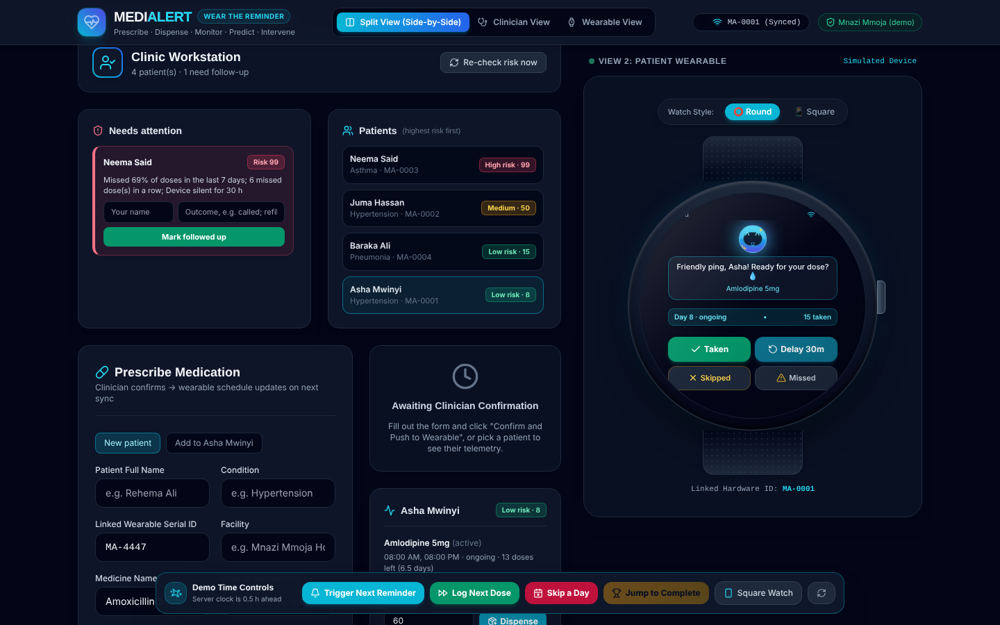

# MediAlert — MVP

Low-cost wearable + hospital/clinician API that keeps patients on their full course —
no smartphone needed. This repo is the first working slice of
**Prescribe → Dispense → Monitor → Predict → Intervene**.



See [`docs/MVP_SPEC.md`](docs/MVP_SPEC.md) for requirements, assumptions, open questions
and architecture.

## What works

| Step | What happens | Where |
|---|---|---|
| Prescribe | Clinician registers patient, pairs the watch, sets drug + daily times, fixed course or ongoing | `POST /api/v1/patients/{id}/prescriptions` |
| Dispense | Doses handed out recorded → supply & refill estimate | `POST /api/v1/prescriptions/{id}/dispense` |
| Monitor | Wearable `sync` gets next dose / buzz / refill alert + course progress; `ack` records **taken**, **snooze 30 min**, **skipped** or **missed**; unconfirmed doses become *missed* after a grace window | `/api/device/v1/sync`, `/api/device/v1/ack` |
| Predict | Transparent risk score (0–1) with plain-language reasons; skipped doses count as not taken; swappable for a trained model | `app/services/risk.py` |
| Intervene | High-risk patients appear in the nurse queue (one open alert per patient); nurse records the follow-up | `/api/v1/interventions` |

**Two interfaces, same backend:**
- **`/`** — the React clinic workstation + simulated smartwatch (`frontend/`).
- **`/classic`** — the original plain HTML dashboard (no build step).
- **`/docs`** — interactive API docs.

## Run it

```bash
python -m venv .venv && source .venv/bin/activate      # Windows: .venv\Scripts\Activate.ps1
pip install -r requirements.txt -r requirements-dev.txt
```

Create a `.env` file (never commit it):

```
MEDALERT_API_KEY=<paste a random key: python -c "import secrets; print(secrets.token_urlsafe(24))">
MEDALERT_DEMO_MODE=1
```

`MEDALERT_DEMO_MODE=1` turns on the demo time controls (fast-forward to the next dose,
skip a day, finish a course, reset). Leave it out for anything except demos.

```bash
python -m scripts.seed_demo        # optional: 4 fictional patients with a week of history
uvicorn app.main:app --reload      # open http://localhost:8000 and paste the key
```

The React UI is already built (`frontend/dist`), so Node is **not** needed just to run it.

### Changing the React UI

Needs Node.js 18+.

```bash
cd frontend
npm install
npm run dev        # http://localhost:3000 — hot reload; /api calls go to the server on :8000
npm run build      # type-checks, then rebuilds frontend/dist that the server serves at /
```

Keep `uvicorn` running in another terminal while using `npm run dev`.

## Demo script (2 minutes)

1. Connect with the key. Neema is already in **Needs attention** — the risk reasons say why.
2. Fill **Prescribe Medication** for a new patient → **Confirm and Push to Wearable**. The watch shows *New Prescription Received*.
3. **Trigger Next Reminder** → the watch buzzes. Try **Delay 30m**, then **Taken**.
4. **Skip a Day** → doses become missed, risk rises, nurse alerts open.
5. **Jump to Complete** → course finishes, celebration.
6. In **Needs attention**, enter your name + outcome → **Mark followed up**.

## Test

```bash
pytest -q                          # backend: 23 tests
cd frontend && npm run typecheck   # UI: TypeScript strict mode
```

## Layout

```
app/
  main.py              app factory, background monitor, serves React build + classic page
  config.py            env/.env settings (no secret defaults)
  models.py            SQLAlchemy tables
  schemas.py           request/response models incl. the tiny device protocol
  security.py          API key (clinicians) + hashed per-device tokens
  api/clinician.py     /api/v1 — patients, prescriptions, dispensing, doses, interventions
  api/device.py        /api/device/v1 — sync, ack (taken/snooze/skipped/missed)
  api/demo.py          /api/demo — time controls, only when MEDALERT_DEMO_MODE=1
  services/schedule.py dose slots (local time → UTC), course totals, completion, refills
  services/adherence.py monitor → features → risk → interventions, course progress
  services/risk.py     RiskModel interface + HeuristicRiskModel v0
  static/              classic dashboard (/classic)
frontend/              React + Vite + Tailwind UI (src/), built output in dist/
  src/api.ts           all calls to the backend
  src/App.tsx          state, polling, watch state machine, demo controls
  src/components/      ClinicianView, WearableView, SmartwatchFrame, …
scripts/seed_demo.py   fictional demo data
tests/                 backend tests
docs/MVP_SPEC.md       requirements, assumptions, architecture
```

## Plugging in a trained model

Implement `predict(features: AdherenceFeatures) -> RiskResult` with a `version` string and
pass it to `create_app(risk_model=...)`. Every assessment stores its input features and
model version in `risk_assessments`, which doubles as a training/evaluation log.

## Not production-ready yet

Shared API key instead of user accounts/roles; SQLite + `create_all` instead of
Postgres + migrations; no audit log; no HTTPS termination; no consent capture; demo mode
must stay off with real patients. See the spec's *Deferred* and *Privacy* sections.
